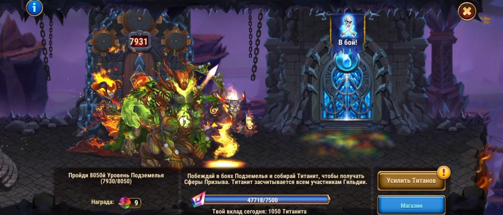
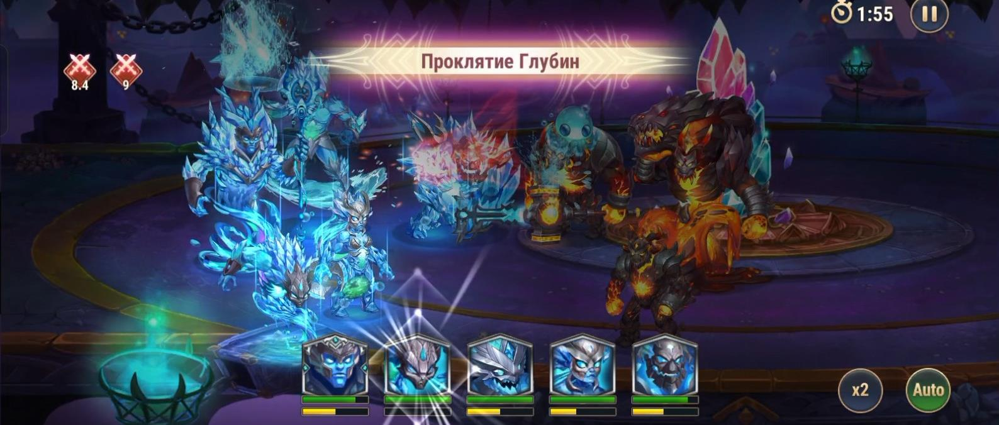
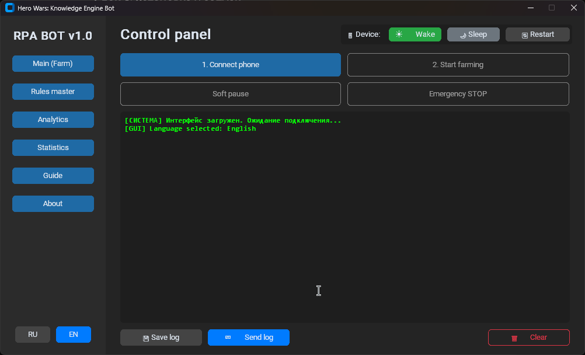
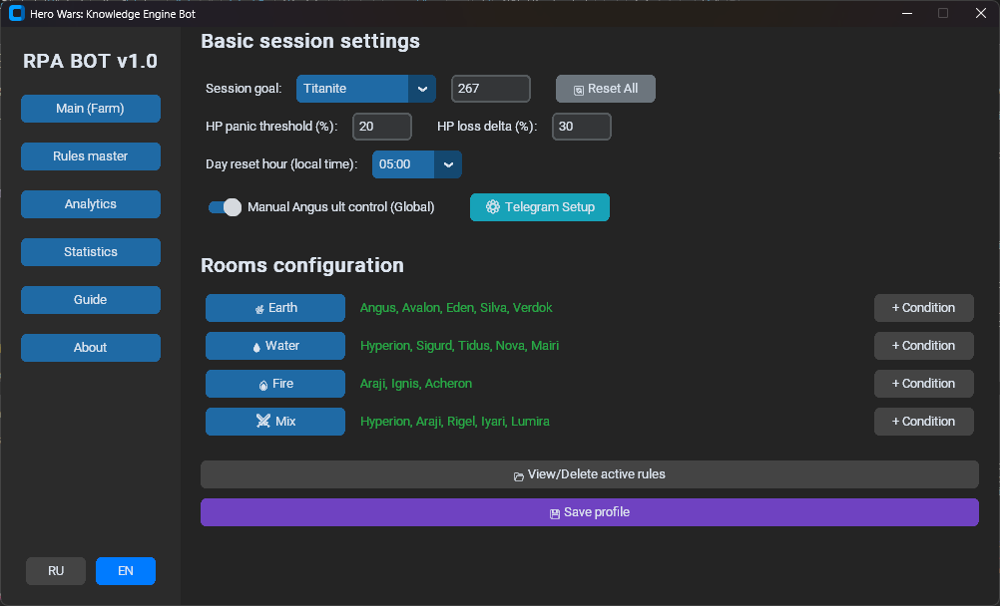
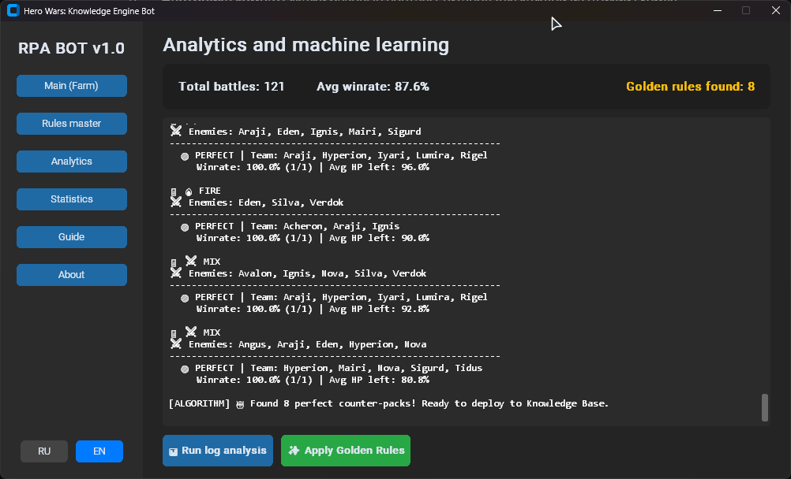
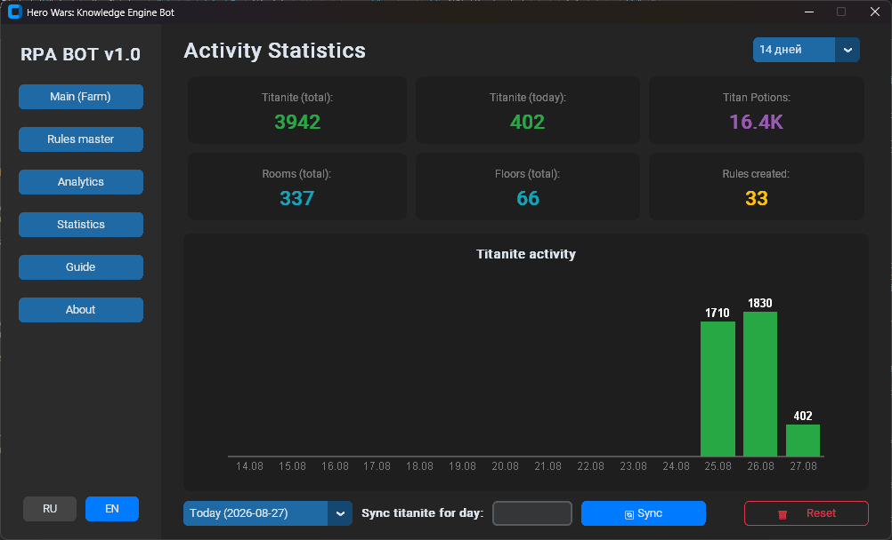
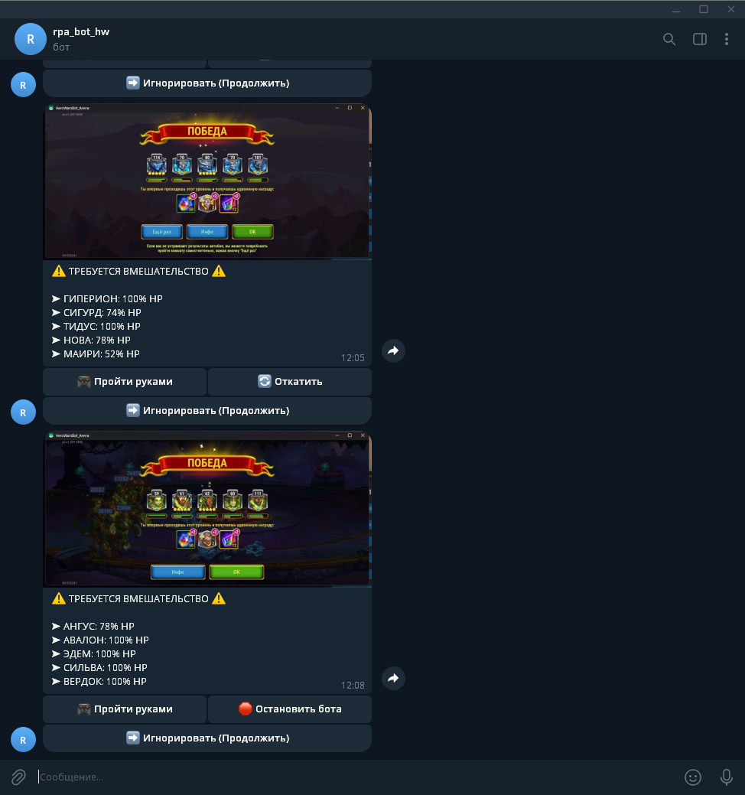

# Hero Wars: Knowledge Engine Bot 🤖⚔️

Game: [Nexters](https://www.nexters.com/en/hero-wars)

The **Knowledge Engine Bot** is a learning project: an RPA (Robotic Process Automation) agent that watches the screen of a *Hero Wars* session mirrored from a phone, reads Titan health and energy, keeps a history of every battle and chooses a team by rules. It was written to study computer vision, state machines and rule engines.

> ### ⚠️ Educational project / Учебный проект
> This project was created **solely for learning and for testing code** (computer vision, state machines, automation of a
> mobile game through a screen mirror). It is not a product and it is not meant for gaining an unfair advantage.
> The rules of *Hero Wars* may restrict or forbid third-party automation programs; I have not checked what the game's
> terms say. Using anything from this repository in the real game is **at your own risk** — the author takes no
> responsibility for blocked accounts or any other consequences.
>
> Проект сделан **исключительно в учебных целях — чтобы учиться и проверять код**. Правила игры могут ограничивать
> или запрещать сторонние программы; автор их не проверял. Использование в настоящей игре — на ваш страх и риск.

Unlike basic auto-clickers that blindly tap the same spots on the screen and break the second your game lags, this bot actually has artificial "vision" and a strict logic engine under the hood:

*   **It sees (Computer Vision):** The bot literally watches your PC screen using OpenCV algorithms. It detects enemy icons and calculates Titan health (HP) and energy levels on the fly using HSV color masks. Since it relies on relative math (percentages) rather than hardcoded pixels, it doesn't care what your monitor's resolution is — it just adapts.
*   **It thinks (State Machine):** The core of the bot runs on a "State Machine" architecture. The software always knows exactly what's happening right now (whether it's standing in the hallway, picking a team, or fighting). This means game animations or emulator lags won't cause it to freeze or glitch out.
*   **It stays outside the game:** The bot **does not** touch the game files, it doesn't inject code into RAM, and it doesn't hook into private APIs. It only looks at your phone's screen mirror (`scrcpy`) and sends taps and swipes through ADB. Its actions are deliberately human-paced: random tap points inside a button, a reaction pause before every tap, no more than two taps per second. This is a design choice for a learning project, not a guarantee that a game would not notice it (see the note above).

---

## 💻 System Requirements / Системные требования

To use the bot, you need a specific hardware and software combination. The bot runs on a PC and controls your mobile device.

- **OS**: Windows (to run the bot software).
- **Device**: Android smartphone.
- **Connection**: USB or Wi-Fi (for screen mirroring and ADB control).
> *Note: Currently, the bot strictly requires a Windows PC paired with an Android device. iOS devices or standalone emulators without Android system architecture are not fully supported yet.*

---

## 🌍 Supported Languages / Поддерживаемые языки

The bot's interface is localized into 13 languages. You can switch the language easily in the settings.

- 🇬🇧 English (EN)
- 🇷🇺 Русский (RU)
- 🇺🇦 Українська (UK)
- 🇰🇿 Қазақша (KK)
- 🇩🇪 Deutsch (DE)
- 🇪🇸 Español (ES)
- 🇫🇷 Français (FR)
- 🇵🇱 Polski (PL)
- 🇵🇹 Português (PT)
- 🇹🇷 Türkçe (TR)
- 🇨🇳 中文 - Simplified (ZH)
- 🇰🇷 한국어 (KO)
- 🇯🇵 日本語 (JA)

---

## ⚙️ Under the Hood (Architecture)

The project relies on a modular architecture where every piece has its own strict job:

*   **State Machine (`main.py`):** The bot's main loop runs as a finite state machine with strict states (`HALLWAY`, `ROOM_SELECTION`, `SET_TEAM`, `WAIT_FOR_OK`). This is a lifesaver — it prevents the bot from freezing or breaking when the game interface lags. It communicates with the GUI process through a non-blocking command queue (`sys.stdin` -> `queue.Queue`).
*   **Computer Vision (`vision.py` & `analyzer.py`):** 
    *   Uses `mss` for high-speed screen capture and `cv2.matchTemplate` to find UI elements.
    *   Implements the Singleton pattern to cache loaded images directly in RAM (`TEMPLATE_CACHE`). It also includes a custom `imread_cyrillic` wrapper for safe file reading on Windows.
    *   Analyzes Titan HP and Energy by applying color HSV masks (isolating green and yellow-white pixels) and calculating their width relative to the base screen resolution.
*   **Rules Engine (`rules_engine.py`):** The decision-making core. It parses your `profile.yml` and room configs. It strictly follows priorities: first, it checks "rescue" rules (critical HP/Energy drops), and only then applies tactical rules (counter-packs against specific enemies).
*   **Analytics (`analytics.py`, `ui/analytics_tab.py`):** Every battle is logged into a `.jsonl` file. The analytics tab calculates the winrate of each team. If a combo hits a Winrate >= 80% over several fights, it can be added to the bot's Knowledge Base as a "Golden Rule" (the bot can also add such rules by itself).
*   **Own decisions (`tactics.py`, `battle_verdict.py`):** After each fight the bot judges whether it went badly (a Titan died, HP below the panic threshold, too much HP lost). With the "Bot decides itself" switch it rolls the fight back and replays with a backup pack, picks the door by Titans' health, builds a healing pack on its own, and decides alone if you do not answer the SOS window in time.
*   **Stuck protection (`stuck_guard.py`):** Time limits for every state and a watchdog (5 minutes without a cleared room → screenshot, Telegram alert, smart restart). A locked PC (Win+L) no longer crashes the bot — it waits for the screen to come back.
*   **Session report (`session_log.py`, `session_limits.py`):** Timings of every stage of every room, a summary block at the end of a session and the same summary in Telegram. Floors are counted by the save point, and when a session limit (time, rooms, Titanite) is reached the bot finishes the current floor first.

---

## 🌟 Key Features & Interface

### 🎛 Control Dashboard:
A modern, dark-themed graphical interface built on `CustomTkinter` with seamless English and Russian (RU/EN/UK/KK/DE/ES/FR/PL/PT/TR/ZH/KO/JA) localization.

This is the heart of the bot. Everything you need to control the farming process is packed into one clean interface:
*   **Simple 2-Click Launch:** First, link your phone (`1. Connect phone`), then fire up the bot (`2. Start farming`). No need to type any console commands.
*   **Direct Device Control:** The `Wake`, `Sleep`, and `Restart` buttons let you manage your phone's screen directly from your PC. You can actually turn the physical screen off to save battery and prevent burn-in while the bot keeps playing in the background.
*   **Safety & Control:** The `Soft pause` button tells the bot to finish the current battle, walk out to the hallway, and wait for you. `Emergency STOP` instantly kills the bot process if something goes wrong.
*   **Live Terminal:** The black console window shows exactly what the bot is thinking and doing in real-time (which room it found, what team it picked, HP stats). The log is also saved by the bot itself into `bot_data/logs/` (see below), so the "Save log" button is optional.

### ⚙️ Smart Rule Builder & Session Master:
A visual constructor that lets you create dynamic, custom tactics. You can command the bot to soft-pause or swap the team if a specific Titan's HP drops below a critical threshold, or if it encounters specific dangerous enemies.

Take full control over the bot's logic without touching a single line of code. All settings are seamlessly mapped to the internal Rules Engine.
*   **Session Limits & Safety:** Define exact farming goals (e.g., collect exactly 267 Titanite). Set global safety nets like `HP panic threshold` and `HP loss delta` — if a Titan unexpectedly loses a huge chunk of health in one fight, the bot will trigger an SOS protocol before a fatal wipe happens.
*   **Tactical Room Config:** Assign default elemental teams for Earth, Water, Fire, and Mix dungeon encounters. 
*   **Dynamic Conditions:** Use the `+ Condition` button to build advanced tactical overrides. Tell the bot to automatically swap team compositions or soft-pause if specific dangerous enemies spawn, or if a Titan's health is running low.
*   **Microcontrol & Alerts:** Global toggles for manual Angus Ultimate timings (to perfectly counter enemies) and one-click Telegram setup for remote alerts.

### 🧠 Analytics & Machine Learning:
The bot logs every single battle into a `.jsonl` database. It automatically calculates the Winrate for each team composition. If a titan combo achieves a winrate of >= 80%, the bot suggests embedding it into its Knowledge Base as a "Golden Rule".

The bot doesn't just blindly farm the Dungeon; it actively learns from every battle it fights.
*   **Data Logging:** Every single encounter is meticulously recorded into a local database. The algorithm tracks the room element, the exact enemy lineup, your chosen team, and the remaining HP of your Titans.
*   **Winrate Analysis:** Hitting the `Run log analysis` button forces the bot to process its entire battle history. The built-in terminal clearly highlights the mathematical efficiency of each team composition, marking the flawless ones as "PERFECT".
*   **Golden Rules Discovery:** If a specific Titan combo consistently dominates with an 80%+ winrate, the algorithm automatically flags it as a perfect counter-pack.
*   **Automated Deployment:** A single click on `Apply Golden Rules` instantly injects all discovered successful tactics directly into the Rules Engine. The bot rewrites its own configuration files on the fly, ensuring it will always prioritize these winning teams against those specific enemies in the future.

### 📈 Activity Statistics & Tracking

To keep track of your daily progress, the bot features a comprehensive, built-in analytics dashboard.
*   **Smart Counters:** It tracks everything: total titanite, floors cleared (counted by the save point, not guessed from the room count), and Titan Potions earned. Large numbers are automatically formatted for a cleaner look (e.g., 16.4K instead of 16400).
*   **Lightweight Native Chart:** The daily titanite activity bar chart is drawn entirely from scratch using the native `Canvas` widget. This keeps the app extremely lightweight because we didn't have to pack heavy data science libraries into the executable.
*   **Game-Day Logic:** Hero Wars resets the daily cap at 5:00 AM. The bot accounts for this by applying a time-shift to all its logs, ensuring that a late-night farming session is correctly assigned to the previous game-day.
*   **Foolproof Synchronization:** If you play a few runs manually on your phone, you can just type your current titanite into the `Sync` field. The algorithm calculates the delta and updates your rooms and potions accordingly. It even has a built-in safeguard: the bot strictly remembers how much it farmed autonomously and will reject any manual input lower than its own baseline.

### 📱 Telegram Integration (SOS Protocol):
Complete remote control. Receive live battle screenshots directly in your Telegram chat if the bot encounters a critical HP drop. You can manually rollback the fight or change the team using inline buttons right from your phone.

The bot keeps you in the loop, even when you're miles away from your PC.
*   **Smart Alerts:** If a battle goes south (e.g., a Titan's HP unexpectedly drops below your safe threshold), the bot refuses to lose. It soft-pauses the game and instantly sends a live screenshot of the battlefield and HP metrics directly to your phone.
*   **Remote Control:** You don't need to rush back to your monitor. Use the inline buttons in your Telegram chat to command the bot: rollback the fight, ignore the drop and push through, or stop farming entirely.
*   **On-the-fly Team Swapping:** If you decide to rollback the battle, the bot will wait for your instructions. Just type a new Titan combination directly into the chat. The built-in text parser will recognize the heroes, rebuild the team in-game, and dive back into the dungeon automatically!

---

## 🗂 Where the bot keeps its data

Everything the bot and the window write by themselves goes into one folder, `bot_data/` (it is not part of the repository):

| What | Where |
|---|---|
| Statistics | `bot_data/stats.json` |
| Working rules (copied from the default `rules/` on first start) | `bot_data/rules/*.yml` |
| Battle history, bot log, stage timings | `bot_data/logs/` — the newest 20 files of each kind are kept, older ones are deleted automatically |
| Screenshots for troubleshooting (SOS window, stuck bot) | `bot_data/debug/` — the newest 50 are kept |
| Titans' HP and energy after the last fight (same game day) | `bot_data/titan_state.json` |
| Copy of the profile (contains the Telegram token — keep it private) | `bot_data/profile.yml.bak` |

All settings are changed in the program window; you never need to edit `profile.yml` by hand. Your own `profile.yml` is kept out of git.

---

## 🚀 Running the code (for study)

This repository is source code to read and learn from.

1. Install Python 3.11 or newer (tick "Add python.exe to PATH") and [scrcpy](https://github.com/Genymobile/scrcpy) (it includes `adb`). Check in `cmd`: `adb devices` must show your phone as `device`.
2. On the phone enable **USB debugging** and **USB debugging (Security settings)** (see the troubleshooting section below).
3. Run `start.bat` from the project folder. The first start creates a `venv` and installs `requirements.txt`, then opens the program window.
4. In the window: `1. Connect phone` → open the game → `2. Start farming`.

**About the image templates.** The bot recognizes the game screen by comparing it with small template pictures (buttons, Titan icons). These pictures are game artwork and are **not** included in this repository (`assets/` is in `.gitignore`). Without them the program window opens, but the bot cannot recognize anything; you would have to make your own screenshots of the game elements.

---

## ⚠️ Important Notes & Troubleshooting

### 🛡️ Antivirus False Positives (Windows Defender)
If you compile the program into an `.exe` yourself (PyInstaller): because it uses low-level Windows API calls (`ctypes`), screen capturing, and ADB (Android Debug Bridge), **Windows Defender or other antivirus software may occasionally flag the compiled `.exe` file as a threat**. 
* This is a very common **false positive** for compiled Python RPA (Robotic Process Automation) tools.
* If the bot gets blocked from launching or is automatically removed by the system, please **add the bot's executable or folder to your antivirus exceptions/exclusions list**.

### 📱 Clicks Not Registering on the Phone?
If the bot successfully connects, opens the game, but **fails to click** or swipe anything, the issue is almost always related to your Android permissions, not the bot itself.

To fix this, go to your phone's **Developer Options** and ensure the following are enabled:
* **USB Debugging:** Must be enabled.
* **USB Debugging (Security settings):** Must be enabled. *This is the most critical step—it explicitly allows ADB to simulate taps and swipes on your screen.*
* **Install via USB:** (On some devices like Xiaomi/MIUI) Must be enabled.

> **Note:** Depending on your phone manufacturer (Realme, Xiaomi, Oppo, Poco, etc.), the "Security settings" toggle might be named slightly differently, but it is always located right under standard USB Debugging. You must grant the system permission to simulate input events.

---

## 📄 License

This project is licensed under the **PolyForm Noncommercial 1.0.0** License. 
The software is provided free of charge strictly for **personal use**. Commercial redistribution, selling of this bot, embedding it into paid services, or claiming it as your own commercial product is **strictly prohibited**.

---
**Developed by Platon Petrunin with the help of AI: 🤖 Google Gemini and 🤖 Anthropic Claude.**
Made for learning and for testing code. / Сделано в учебных целях и для проверки кода.
